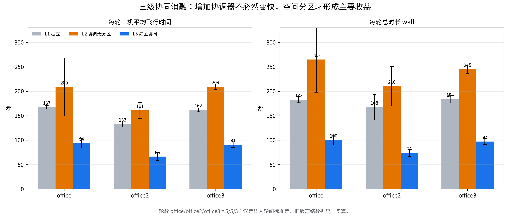

# 三级协同消融实验

日期：2026-11-15  
数据来源：2026-10-16 至 2026-10-17 已冻结的 `office / office2 / office3` 批跑结果

## 1. 实验定义

这里的三级不是三台无人机，而是协同能力逐级增加：

| 等级 | 配置 | 新增能力 |
|---|---|---|
| L1 | 三机独立 | 每台飞机各自覆盖全图，无协调器 |
| L2 | 协调器无空间分区 | 增加前沿任务池、分配、租约与统一 HALT |
| L3 | 协调器加扇区分区 | 在 L2 上增加一维 Voronoi 扇区，任务创建即归属扇区机 |

单机 A 作为外部参考，不属于三级多机协同消融。

## 2. 复算结果

表中“单机时间”是每轮三机飞行时间均值的轮间统计，wall 为每轮总时长；轮数按原冻结核验。

| 场景 | 等级 | 单机时间均值 (s) | wall 均值 (s) | 轮数 |
|---|---|---:|---:|---:|
| office | L1 三机独立 | 167.2 ± 3.6 | 183.0 ± 6.6 | 5 |
| office | L2 协调无分区 | 208.8 ± 59.3 | 265.0 ± 67.0 | 5 |
| office | L3 扇区协同 | **94.0 ± 10.0** | **100.4 ± 10.4** | 5 |
| office2 | L1 三机独立 | 132.9 ± 6.1 | 167.6 ± 26.3 | 5 |
| office2 | L2 协调无分区 | 160.9 ± 16.3 | 210.4 ± 40.6 | 5 |
| office2 | L3 扇区协同 | **66.4 ± 8.3** | **73.8 ± 7.6** | 5 |
| office3 | L1 三机独立 | 161.9 ± 3.8 | 184.0 ± 7.9 | 3 |
| office3 | L2 协调无分区 | 209.4 ± 5.5 | 245.0 ± 8.5 | 3 |
| office3 | L3 扇区协同 | **90.7 ± 5.9** | **97.3 ± 6.1** | 3 |

## 3. 逐级增量

### L1 → L2：只增加协调器，性能反而下降

| 场景 | 单机时间变化 | wall 变化 |
|---|---:|---:|
| office | +24.9% | +44.8% |
| office2 | +21.1% | +25.5% |
| office3 | +29.3% | +33.2% |

这一步说明，单纯增加任务池和最近机分配并不能产生协同收益。日志显示任务被分散到全图，重复覆盖仍为 94%–98%，还叠加了释放与重派开销。

### L2 → L3：增加空间分区后出现主要收益

| 场景 | 单机时间变化 | wall 变化 |
|---|---:|---:|
| office | −55.0% | −62.1% |
| office2 | −58.7% | −64.9% |
| office3 | −56.7% | −60.3% |

与 L1 三机独立相比，L3 的单机时间降低 43.8%、50.0%、44.0%，wall 降低 45.1%、56.0%、47.1%。

## 4. 结论

这组三级消融支持以下归因：

1. “有多机”本身不保证效率提升，三机独立仍会重复覆盖全图。
2. “有协调器”也不自动带来提升；没有空间分区时，任务级协调甚至比独立模式更慢。
3. 本作品的主要收益来自把协调落实到空间分工：每架飞机从初始位置直接处于自己的扇区，只探索、上报和执行本扇区前沿。

因此报告中的主结论应写成“扇区分区协同优于三机独立”，不能简化成“只要多机协同就更快”。

## 5. 口径与限制

- L1/L2/L3 使用的是同一套 FAEP 单机栈和同一组仿真地图。
- 三个场景的轮数为 office 5、office2 5、office3 3；office3 样本较少。
- 覆盖指标为轨迹邻域近似，不是 SDF 地图精确覆盖。
- 该表是对既有冻结数据的统一复算和消融整理，没有把旧轮次重新冒充新实验。
- 当前决赛分支新增的目标搜索默认关闭。关闭目标搜索的 office2 回归 wall 为 74 s，与旧 L3 的 73.8 s 基本一致。

逐级数据见 `data/coordination_level_ablation_results_20261115.csv`。原始记录见 `data/多机大场景实验_results_20261016.txt` 及 `D:\WSL\multi_big_results_prepartition.txt`。
