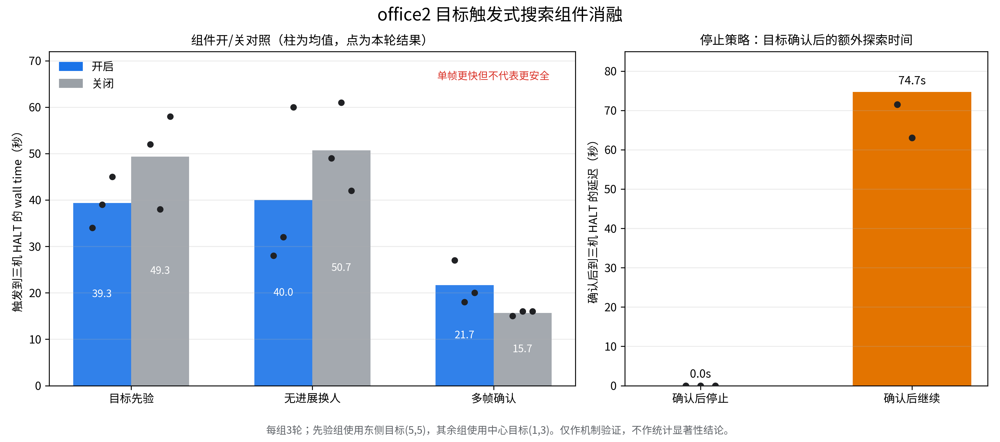

# 目标触发式搜索组件消融实验

日期：2026-11-15  
场景：上游 FAEP 自带 `office2`，不是算法对抗赛地图

## 1. 为什么补做消融

前面几轮已经验证了“目标存在时能停止、目标不存在时能兜底”，但这只能说明系统能工作，不能说明每个新增组件分别起了什么作用。本轮把目标先验、无进展换人、多帧确认和确认后停止逐一关闭，观察同一套仿真环境中的时间变化。

所有配置默认保持正式代码行为不变，只通过 launch 参数切换。每组运行 3 轮。实验样本量仍然很小，只用于判断机制是否确实产生行为差异，不做显著性检验。

## 2. 对照设置

| 消融项 | 开启配置 | 关闭配置 |
|---|---|---|
| 目标先验 | 目标 `(5,5)`，先验中心 `(5,5)` | `target_prior_enabled:=false` |
| 无进展换人 | 严格双机确认，10 秒无视觉进展换人 | 换人时限设为 999 秒 |
| 多帧确认 | 2.5 秒内连续 3 帧 | `confirm_frames:=1`，单帧即可确认 |
| 确认后停止 | `target_stop_on_confirm:=true` | 确认后继续探索全图 |

其他公共参数：

- 模拟检测率：0.92；
- 位置噪声：0.08 m；
- 置信度噪声：0.05；
- 最大感知距离：8 m；
- 实验结束条件：三架飞机均收到 HALT。

先验消融使用东侧目标 `(5,5)`。中心位置离 D3 初始位置太近，关闭先验也常能很快看到目标，无法体现先验搜索的作用。

## 3. 汇总结果

| 组件 | 开启时均值 / 中位数 | 关闭时均值 / 中位数 | 观察 |
|---|---:|---:|---|
| 目标先验 | 39.3 / 39.0 s | 49.3 / 52.0 s | 均值缩短 10.0 s，约 20% |
| 无进展换人 | 40.0 / 32.0 s | 50.7 / 49.0 s | 均值缩短 10.7 s，约 21% |
| 多帧确认 | 21.7 / 20.0 s | 15.7 / 16.0 s | 单帧更快约 6 s，但失去稳定性门槛 |
| 确认后停止 | 确认后 0.0 s 停止 | 确认后平均再飞 74.7 s | 停止策略的收益最明确 |



逐轮数据：

| 配置 | 三轮结果（s） | 结果 |
|---|---|---|
| 完整方案 | 27 / 18 / 20 | 3/3 确认，三机停止 |
| 先验开，目标 `(5,5)` | 34 / 39 / 45 | 3/3 确认，三机停止 |
| 先验关，目标 `(5,5)` | 52 / 38 / 58 | 3/3 确认，三机停止 |
| 严格双机，换人开 | 28 / 32 / 60 | 3/3 交叉确认 |
| 严格双机，换人关 | 49 / 61 / 42 | 3/3 仍由自然第二架飞机确认 |
| 单帧确认 | 15 / 16 / 16 | 3/3 首次检测即停止 |
| 确认后继续 | 92 / 85 / 108 | 3/3 最终探索完整张地图 |

“确认后继续”三轮中，从目标确认到三机 HALT 的额外时间分别为 71.48、63.04、89.47 秒。正式策略在确认时立即发布 HALT，因此该延迟近似为 0。

日志也能看到组件是否实际生效：换人开启的三轮分别发生 `1 / 1 / 4` 次无进展换人，关闭组为 `0 / 0 / 0`；3 帧配置都进入过 `VERIFYING`，单帧配置三轮均未进入复核态。

## 4. 结论应该怎样写

可以确认的三点：

1. 目标先验在这个东侧目标场景中缩短了发现时间，但结果波动较大，不能说它对所有目标位置都稳定有效。
2. 无进展换人缩短了严格双机复核的平均等待时间，主要价值是避免在一架复核机上无效等待。
3. 发现目标后立即停止前沿扩展，是收益最大、最稳定的机制。

单帧确认虽然最快，但不能写成算法改进。它只是把 3 帧门槛去掉，单次检测即可结束任务，降低了误确认防护，不能拿 15.7 秒与完整方案 21.7 秒直接得出“更优”。

## 5. 限制

- 每组只有 3 轮，运行结果重叠明显，尤其先验和换人组，不足以做显著性结论。
- 感知仍是模拟节点，没有真实 RGB 漏检、误检和人物运动。
- 消融只覆盖 `office2` 中心与东侧目标，没有覆盖多目标、动态遮挡和真实飞行。
- “确认后继续”仍使用同一套前沿探索，没有专门优化找到目标后的观察策略。

## 6. 复现

组件消融：

```bash
ABLATION_RUNS=3 \
TARGET_SEARCH_OUT_DIR=/mnt/d/WSL/target_search_ablation_20261115 \
bash scripts/run_target_search_ablation_suite.sh
```

目标先验专项对照：

```bash
ABLATION_RUNS=3 \
TARGET_SEARCH_OUT_DIR=/mnt/d/WSL/target_search_ablation_20261115 \
bash scripts/run_target_prior_ablation.sh
```

汇总和成图：

```bash
ABLATION_LOG_DIR=/mnt/d/WSL/target_search_ablation_20261115 \
python3 scripts/analyze_target_search_ablation.py
```

逐轮结果见 `data/target_search_ablation_results_20261115.csv`，原始日志位于 `D:\WSL\target_search_ablation_20261115`。
