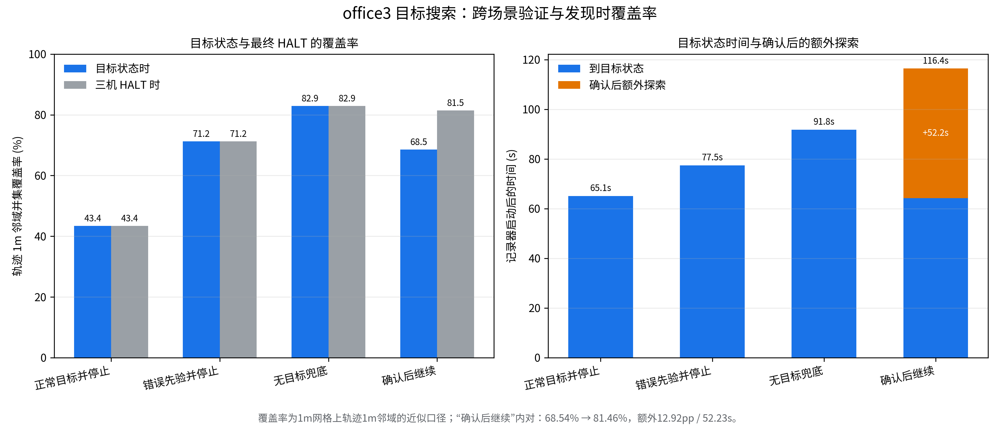

# 目标搜索跨场景与发现时覆盖率验证

日期：2026-11-15  
新增场景：`office3`（19.7 m × 28.8 m）  
原有场景：`office2`

## 1. 本轮补了什么

此前目标搜索主要只在 office2 验证，且只统计确认时间，没有回答“发现目标时到底探索了多少区域”。本轮补做两项：

1. 在 office3 跑正常目标、错误先验和无目标兜底。
2. 在目标确认瞬间冻结三机轨迹并计算并集覆盖率，再与最终 HALT 对比。

覆盖口径沿用仓库原有方法：1 m 网格上，对每架飞机的轨迹做 1 m 邻域扩张，再计算三机并集。它是轨迹覆盖近似，不是 RGB 相机视场精确覆盖，但可以与旧实验直接比较。

## 2. office3 跨场景结果

目标点选在 `(7, -10, 1)`，位于 office3 南侧自由区。错误先验故意放在同扇区西端的 `(-7, -10)`。

| 场景 | wall | 结果 | 目标状态时覆盖 | HALT 时覆盖 | 说明 |
|---|---:|---|---:|---:|---|
| 正常目标 | 55 s | 确认并停止 | 43.41% | 43.41% | 单机多帧确认 |
| 错误先验 | 71 s | 确认并停止 | 71.22% | 71.22% | 先验错误但继续扩大搜索 |
| 无目标 | 85 s | `NOT_FOUND` | 82.93% | 82.93% | 全图兜底，三机 HALT |
| 目标确认后继续 | 110 s | 最终全图完成 | 68.54% | 81.46% | 确认后额外 52.23 s、12.92 个百分点 |

正常目标一轮为 55 秒；错误先验多花约 16 秒，但仍成功找到。无目标完成全图时覆盖率 82.93%，与 office2 的 92 秒/全图结果量级一致。

## 3. 发现时覆盖率的意义

“确认后继续”这组在同一轮运行中同时记录了两个时刻：

- 目标确认时：覆盖率 **68.54%**；
- 三机最终 HALT 时：覆盖率 **81.46%**；
- 额外覆盖：**12.92 个百分点**；
- 额外耗时：**52.23 秒**。

这说明目标确认时确实没有完成全图探索，继续探索会额外增加约八分之一自由区的轨迹覆盖。正式策略在确认时停止，避免的就是这部分与任务目标无关的工作量。



## 4. 现在可以怎样表述

可以写成：目标触发式搜索已在 office2 和 office3 两类地图上完成机制验证，office3 的正常目标、错误先验和无目标兜底均通过；目标确认时覆盖率明显低于最终全图，停止策略减少了目标找到后的额外探索。

仍需注明：

- office3 每个场景只跑了 1 轮，作用是跨场景烟测，不是统计显著性结论；
- 覆盖是轨迹邻域近似；
- 感知仍是模拟节点，目标是静态的，地图使用上游 FAEP 自带场景。

逐场景原始覆盖 JSON、回归摘要和 TSV 位于 `data/office3_target_search_raw_20261115/`；汇总见 `data/target_search_office3_coverage_20261115.csv`。

复现入口：

```bash
TARGET_SEARCH_MAP=office3 \
TARGET_SEARCH_OUT_DIR=/mnt/d/WSL/target_search_office3_20261115 \
bash scripts/target_search_regression.sh office3_normal confirmed \
  target_x:=7.0 target_y:=-10.0 target_z:=1.0 \
  target_prior_x:=7.0 target_prior_y:=-10.0 target_prior_z:=1.0 \
  target_prior_radius:=3.0 target_prior_growth:=0.05 \
  target_prior_max_radius:=10.0 target_sensor_max_range:=8.0
```
