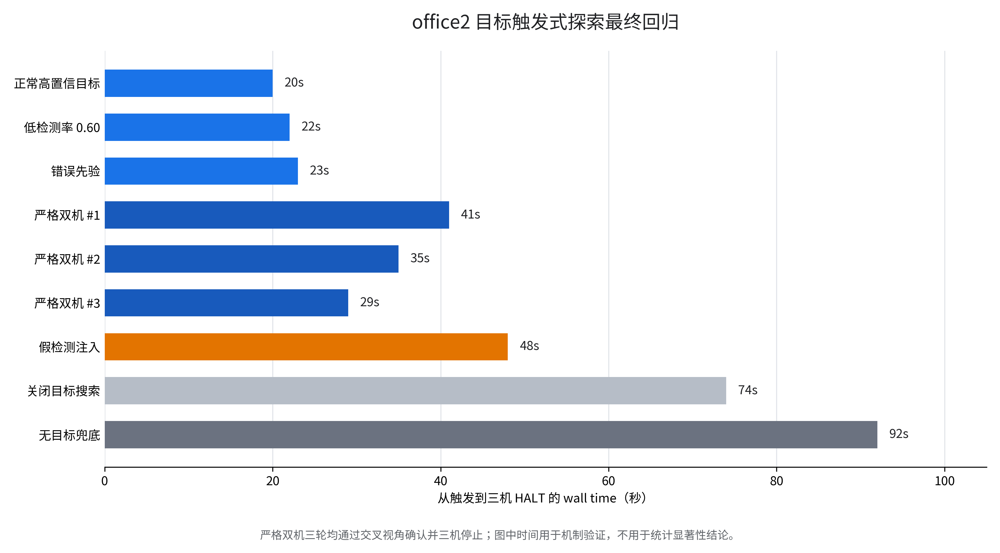
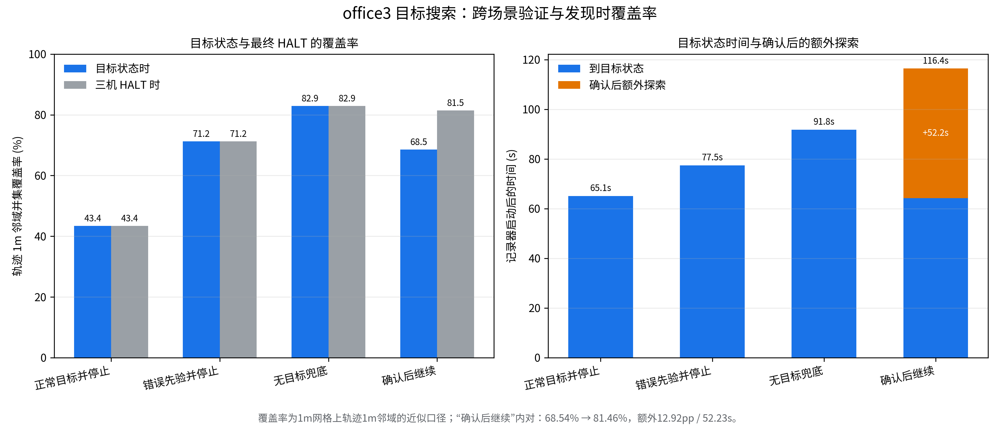

# 目标触发式搜索最终回归（2026-11-15）

## 1. 本次完成的改动

这轮不是重新设计整套多机探索算法，而是补齐“发现目标后怎样安全收尾”的工程闭环。当前分支保留了原有的前沿探索、扇区协同和故障接管逻辑，在协调器中加入以下约束：

1. 任务未真正开始前不接收目标检测，避免飞机还在 `WAIT_TRIGGER` 时产生启动期误确认。
2. 新检测与当前候选位置偏差超过 1.5 m 时直接忽略，防止随机误报把证据集合拉偏。
3. 候选机与复核机在同一个复核窗口内锁定，复核机自己看到目标时只记为证据，不再触发两架飞机角色对调。
4. 指定复核机连续 10 秒既没有视觉证据、也没有完成确认时，把复核任务交给另一架飞机；目标位置和候选机保持不变。
5. 模拟感知增加可配置检测概率、位置噪声和置信度噪声，便于做低检测率回归。

新增参数：

| 参数 | 默认值 | 作用 |
|---|---:|---|
| `target_detection_probability` | 0.92 | 模拟相机的基础检测概率 |
| `target_position_noise` | 0.08 m | 检测位置高斯噪声标准差 |
| `target_confidence_noise` | 0.03 | 检测置信度高斯噪声标准差 |
| `target_position_tolerance` | 1.5 m | 新检测与当前候选的最大位置偏差 |
| `target_verifier_switch_timeout` | 10.0 s | 复核机无视觉进展后的换人时限 |

## 2. 验证条件

主要回归使用仓库自带的 `office2` 仿真点云，跨场景验证使用 `office3`，均不使用算法对抗赛地图。三机均从 `WAIT_TRIGGER` 状态开始，由统一脚本依次触发。

严格交叉确认实验把单机高置信阈值提高到 `1.0`，而模拟感知的输出上限为 `0.99`。因此只要最终显示 `second-drone cross-view confirmation`，就不可能是单机连续三帧“碰巧通过”。

## 3. 最终结果

| 场景 | 轮次 | wall | 结果 | 说明 |
|---|---:|---:|---|---|
| 中央目标，正常检测率 | 1 | 20 s | 确认并停止 | D3 单机连续帧确认 |
| 中央目标，检测率降到 0.60 | 1 | 22 s | 确认并停止 | 弱检测下没有误停，后续仍形成确认 |
| 目标在东侧、先验故意放到西侧 | 1 | 23 s | 确认并停止 | 记录到 7 次“先验范围无前沿，转全局探索” |
| 严格双机交叉确认 | 3 | 41 / 35 / 29 s | 3/3 确认并停止 | 每轮三机均收到 HALT |
| 注入远离候选的高置信假检测 | 1 | 48 s | 假检测被拒绝，真实目标仍确认 | 假点距候选 9.99 m，触发一致性拦截 |
| 目标不存在 | 1 | 92 s | `NOT_FOUND` | 全图兜底后三机停止，无误停、无候选标记 |
| 关闭目标搜索的普通三机协同 | 1 | 74 s | 全图探索完成 | 原有协同模式未被破坏 |



严格交叉确认的三轮中，D3 首先给出候选，最近的 D2 成为复核机。D2 在 10 秒内没有形成视觉证据后，协调器把复核任务交给 D1；候选来源仍保持为 D3，最后均在 D1/D2 提供的第二组证据下确认。与优化前的约 85 秒单轮结果相比，三轮都控制在 41 秒以内。

### 3.1 office3 跨场景补充

office3 南侧目标位于 `(7,-10,1)`。正常目标、错误先验和无目标兜底各运行一轮：

| 场景 | wall | 结果 | 目标状态时覆盖 | HALT 时覆盖 |
|---|---:|---|---:|---:|
| 正常目标 | 55 s | 确认并停止 | 43.41% | 43.41% |
| 错误先验放在 `(-7,-10)` | 71 s | 确认并停止 | 71.22% | 71.22% |
| 目标不存在 | 85 s | `NOT_FOUND` | 82.93% | 82.93% |
| 确认后继续探索 | 110 s | 最终全图完成 | 68.54% | 81.46% |

覆盖率采用与旧实验一致的轨迹投影口径：1 m 网格、轨迹 1 m 邻域、三机并集。目标确认后继续探索时，确认到 HALT 额外增加 12.92 个百分点覆盖，并多花 52.23 秒。正式策略在确认时停止，避免的正是这部分额外探索。



office3 每类场景只有一轮，因此只能作为跨场景烟测，不能作为统计显著性结论。完整记录见 `目标搜索跨场景与覆盖率_2026-11-15.md`。

## 4. RViz 标记检查

实际订阅 `/target/marker` 得到：

- 候选阶段：`SPHERE`，黄色，`scale.x=0.35`；
- 确认阶段：`CYLINDER`，绿色，`scale.x=0.5`、`scale.z=1.7`；
- 无目标实验全程没有生成候选或确认标记。

这说明规划器没有读取目标真值，RViz 展示的是协调器根据 `/target/detection` 形成的候选和确认状态。

## 5. 可以怎样表述

比较稳妥的表述是：FAEP-Multi 增加了一个目标触发式任务闭环，能在目标存在时优先搜索先验区域，在弱证据下继续验证，在目标确认后停止前沿扩展并悬停观察，在目标不存在时完成全图兜底并返回 `NOT_FOUND`。

不宜表述成：已经实现真实 RGB 人物检测、真实飞行避障或通用的动态目标跟踪算法。当前感知为模拟节点，目标是静态的，地图是上游 FAEP 自带场景。

目标搜索已在 office2 和 office3 上完成机制验证；office3 每个场景仅一轮。

## 6. 复现

单场景回归入口：

```bash
bash scripts/target_search_regression.sh \
  active_switch_final confirmed \
  target_x:=1.0 target_y:=3.0 target_z:=1.0 \
  target_prior_x:=1.0 target_prior_y:=3.0 target_prior_z:=1.0 \
  target_prior_radius:=3.0 target_prior_growth:=0.05 \
  target_prior_max_radius:=8.0 target_sensor_max_range:=8.0 \
  target_high_confidence:=1.0 \
  target_verification_sources:=2 \
  target_verification_timeout:=20.0 \
  target_verifier_switch_timeout:=10.0
```

如果需要注入一条远离候选的假检测，在命令前增加：

```bash
TARGET_SEARCH_INJECT_INCONSISTENT=1
```

切换 office3：

```bash
TARGET_SEARCH_MAP=office3
```

原始结果表见 `data/target_search_results_20261115.csv`。

组件级开/关对照见 `目标搜索消融实验_2026-11-15.md`。其中目标先验、无进展换人和确认后停止均做了三轮消融；单帧确认只作为负向对照，不作为性能改进结论。
